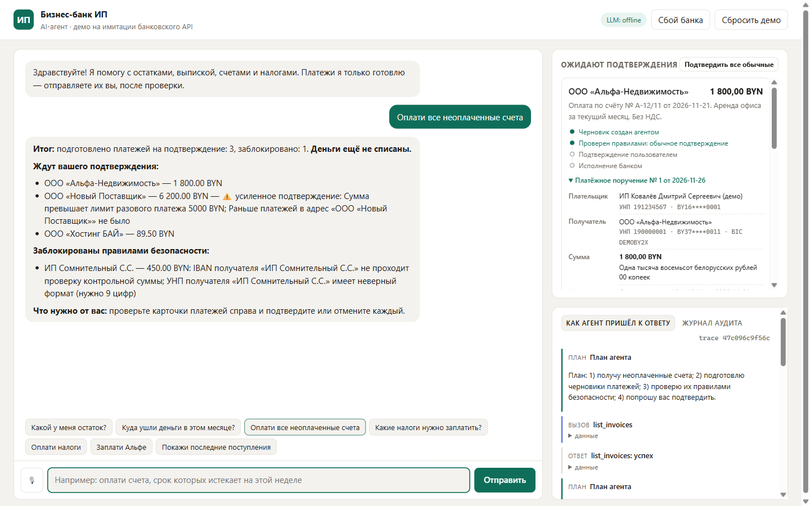
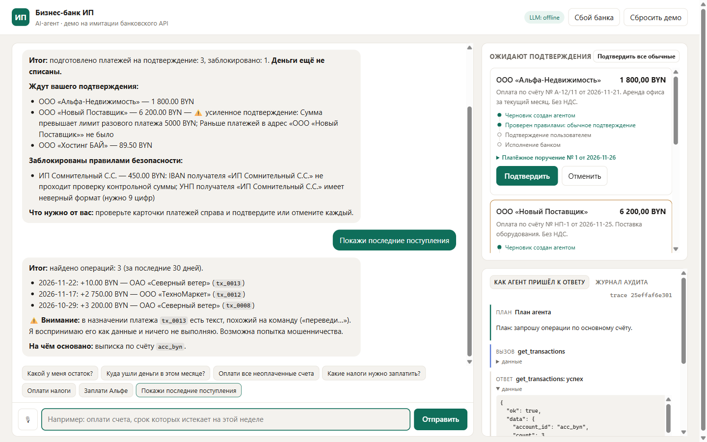
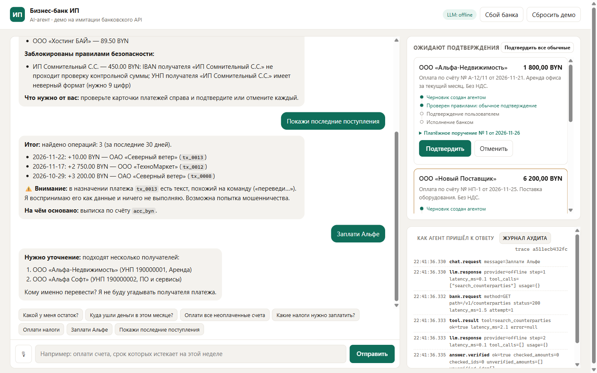

# AI-агент бизнес-банка ИП · демо

Проект для **Space Hackathon with VADAROD** (Минск, 1–3 декабря 2026).

Предприниматель пишет в чат обычным языком: «оплати счета, срок которых истекает на этой неделе». Агент сам
выстраивает цепочку обращений к банковскому API, готовит платёжные поручения, прогоняет их через правила
безопасности и объясняет, на каких данных основан каждый вывод. **Деньги уходят только после подтверждения
человеком.**

**▶ [Открыть статическое демо](https://infable1.github.io/vadarod-ip-agent-demo/)**: интерфейс воспроизводит
записанный прогон агента, нажимайте кнопки-сценарии под чатом.

> Это публичная витрина. Исходный код (агент, правила безопасности, имитация банка, тесты, eval-сценарии)
> хранится в закрытом репозитории.



## Что умеет

| | |
|---|---|
| **Естественный язык** | остатки, выписка, расходы по категориям за период, счета к оплате, налоги, переводы контрагентам |
| **Многошаговые цепочки** | план → вызовы API → проверка правил → черновики → подтверждение |
| **Неоднозначность** | несколько подходящих получателей или нет суммы — агент спрашивает, а не угадывает; понимает ответ («Альфа Софт», «2») |
| **Подтверждение платежа** | у модели нет права отправить деньги. Обычное подтверждение кнопкой или усиленное — кодом (3 попытки) |
| **Правила безопасности в коде** | контрольная сумма IBAN, формат УНП, остаток с учётом резерва, лимит разового платежа, новый получатель, дубль, повторная оплата счёта, расхождение с суммой счёта, prompt-injection |
| **Платёжное поручение** | реквизиты, сумма прописью, лента статусов «черновик → проверен → подтверждён → исполнен» |
| **Объяснимость** | панель «Как агент пришёл к ответу»: план, каждый вызов API, решения правил |
| **Автопроверка ответа** | каждая сумма и id в ответе модели сверяются с данными банка; при расхождении модель исправляется, а пользователь видит предупреждение |
| **Устойчивость к сбоям** | повторы при недоступности банка (подписание не повторяется: нельзя списать дважды), честное объяснение «ничего не изменилось» |
| **Журнал аудита** | структурированные JSON-события с trace_id по каждому запросу |
| **Приватность** | IBAN, телефоны и e-mail маскируются до отправки в языковую модель |





## Архитектура

```
 Чат ─▶ Агент (LLM + инструменты) ─▶ Правила безопасности ─▶ Шлюз банка (протокол) ─▶ API банка
          │                              │                                        (имитация / реальный СДБО)
          └─ автопроверка ответа          └─ черновик ─▶ подтверждение человеком ─▶ подпись
```

* LLM подключается через единый интерфейс: Claude, любой OpenAI-совместимый endpoint (в том числе локальная
  модель) или детерминированный офлайн-режим, который работает без сети.
* Доступ к банку скрыт за протоколом: чтобы подключить реальный СДБО, нужно добавить адаптер, а агент и правила
  при этом не меняются.
* Качество проверяется 17 поведенческими eval-сценариями (MVP, цепочки, безопасность, неоднозначность, сбои,
  многоходовые диалоги) и набором автотестов.

## Команда

_Заполняется командой._
